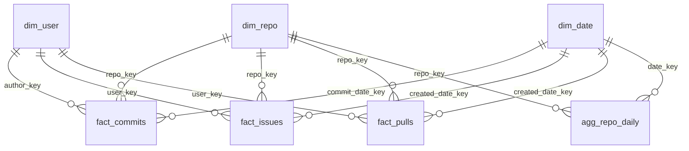

# Who actually keeps an open-source project alive?

A small lakehouse that pulls a year of GitHub activity for four Python projects and turns it into answers to questions a maintainer or a curious contributor would ask:

- Is this project speeding up or slowing down?
- Do issues get closed, or do they pile up?
- How long does a pull request wait before it is merged?
- How much of the work is done by how few people?

Repos studied: `psf/requests`, `pallets/flask`, `tiangolo/fastapi`, `scikit-learn/scikit-learn`.
Window: 1 Oct 2025 to 1 Oct 2026 as the full load, then daily incrementals on top.
Stack: GitHub REST API, Databricks Free Edition (serverless), Delta Lake, Unity Catalog, Power BI.

Data Engineering semester project.
M. Abuzar Rizwan (24L-2535) and Muhammad Hamza Baqir (24L-2505).

---

## What the data says

These are the numbers the Power BI report shows after the last run.

| | |
|---|---|
| Commits | 3,127 |
| Distinct contributors | 337 |
| PR merge rate (all four repos) | 48.4% |
| Share of commits by the top 10 people | 59.4% |

Three things stood out and are worth more than the totals:

1. **The mean lies about review speed.** The average time to merge a PR is about 484 hours, but the median is 4 to 6 hours for flask, requests and fastapi and 39 hours for scikit-learn. A handful of PRs that sat for months drag the mean up. That is why the dashboard has a "Responsiveness" page built on medians (`percentile_approx`) next to the averages.
2. **One person is about a sixth of all commits.** `tiangolo` has 518 of 3,127, more than the next four contributors combined. fastapi is a one-maintainer project in practice; scikit-learn's work is spread over dozens of people.
3. **Issues in scikit-learn wait a long time.** Median time to close an issue is 361 hours there, against 1 to 3 hours for the other three. Different projects, very different triage cultures.

---

## How the data moves

```
GitHub REST API
      |  extract_raw.py  (resumable, rate-limit aware, watermark file)
      v
RAW      /Volumes/workspace/landing/raw/{full|incremental}/{batch_date}/{owner__repo}/{commits|issues|pulls}/page_NNNN.jsonl
      |  02_raw_to_bronze   explicit schema, PERMISSIVE read, bad rows -> quarantine, MERGE
      v
BRONZE   workspace.bronze.{commits, issues, pulls, quarantine}
      |  03_bronze_to_silver   typed timestamps, SHA-256 on emails, derived metrics, MERGE
      v
SILVER   workspace.silver.{commits, issues, pulls, quarantine}
      |  04_silver_to_gold   star schema + serving tables
      v
GOLD     workspace.gold.{dim_*, fact_*, agg_repo_daily, gold_*}
      |  Databricks connector (Import mode)
      v
Power BI   dashboard/Repo_Analytics_Dashboard.pbix

Every step of every layer writes a row to workspace.ops.pipeline_execution_logs.
run_pipeline orchestrates 02 -> 03 -> 04 for one batch.
```

Raw files stay in the Databricks volume and are not committed to Git (`raw/` in this repo only holds the two small Phase 1 samples).

## Repository map

```
extract_raw.py                    GitHub extractor, run from inside Databricks via 00_extract
extract_samples.py                Phase 1 sample generator (kept for history)
notebooks/
  00_setup                        schemas (landing, bronze, silver, gold, ops) + raw volume
  00_logging                      ops.pipeline_execution_logs table + write_log()
  00_extract                      wrapper that runs extract_raw.py (token comes from a widget)
  01_config_schemas               every StructType in one place, plus primary keys
  02_raw_to_bronze                Raw -> Bronze
  03_bronze_to_silver             Bronze -> Silver
  04_silver_to_gold               Silver -> Gold
dashboard/
  Repo_Analytics_Dashboard.pbix   Power BI report
  Repo_Analytics_Dashboard_final.pdf   exported pages
raw/                              Phase 1 samples only
```

---

## Design decisions, and the reason behind each

**Serverless has no `.cache()`.** Bronze needs to read the raw files once, split good rows from bad, and use both halves. Without cache, that would re-read the files twice and could give two different answers. So the parsed batch is written to a throwaway staging Delta table (`bronze._stg_<entity>`), both halves are read from it, and it is dropped in a `finally` block.

**Bad rows are kept, not dropped.** The read is `PERMISSIVE` with `_corrupt_record`. A row that does not fit the declared schema goes to `bronze.quarantine` with the file it came from and its raw text; the rest of the batch continues. Silver has its own quarantine table for rows that parse but fail casting. `06_schema_drift_test` proves it: one good row with an unknown extra field loads, one row with `comments: "many"` lands in quarantine.

**A backfill must not undo newer data.** The first version of the Bronze MERGE updated any matching row. Re-running an old batch would then overwrite a newer version of an issue with a stale one. The merge for issues and pulls now has `WHEN MATCHED AND s.updated_at >= t.updated_at`. Commits are immutable, so they skip the guard. We found this by thinking through the backfill demo before running it, not by getting bitten.

**Keys are hashes, and `NULL` hashes to 42.** Surrogate keys use `xxhash64` on the natural key (repo name, login, `yyyyMMdd` for dates), so every layer can compute them independently and dimensions can be loaded in any order. The catch: `xxhash64(NULL)` is the constant `42`, so every commit from a deleted GitHub account quietly became "author 42". `user_key()` now returns `NULL` when the login is `NULL`, and the contributor tables filter those rows out.

**Facts are merged, aggregates are rebuilt.** `fact_commits`, `fact_issues`, `fact_pulls` are MERGEd on their business key for the rows touched by the batch, so reruns do not duplicate. `agg_repo_daily` and the four `gold_*` serving tables are derived from the facts, so they are simply overwritten, which is cheaper than being clever.

**Issues and pulls are separated properly.** GitHub's issues endpoint also returns pull requests. `fact_issues` filters `is_pr = false`; PRs come only from the pulls endpoint, so nothing is counted twice.

**Emails never leave Bronze in the clear.** Author and committer emails are SHA-256 hashed in Silver and only the hash reaches Gold and Power BI.

**Failure is read from the log table, not from exceptions.** Each layer catches its own errors, writes a `FAILURE` row and moves on to the next entity. `run_pipeline` then queries the log for failures since it started and stops before the next layer. That gives one place to look, and the six `FAILURE` rows from our early runs are deliberately still in the table as evidence.

**Resumable extraction.** Pages are written as `.tmp` then renamed, so a page file is complete or absent. A killed run picks up where it stopped; a `_SUCCESS` marker means the batch is finished. The watermark only moves after a complete run over all four repos, so a partial `--repos` run cannot skip data.

---

## Gold model



| Table | Grain | Notes |
|---|---|---|
| `dim_repo` | one row per repository | `repo_key`, `repo_name`, `owner`, `repo` |
| `dim_user` | one row per GitHub login | `user_key`, `login`; no emails |
| `dim_date` | one row per day, 2025-01-01 to 2027-12-31 | year, quarter, month, week, weekday, `is_weekend` |
| `fact_commits` | one commit | `(repo_key, sha)`, hashed emails, message length |
| `fact_issues` | one issue (PRs excluded) | state, label count, comments, hours to close |
| `fact_pulls` | one pull request | merged flag, additions/deletions, files changed, hours to merge |
| `agg_repo_daily` | repo x day | commits, active authors, issues opened/closed, PRs opened/merged |
| `gold_contributor_activity` | repo x user x month | feeds the Contributors page |
| `gold_repo_momentum` | repo x month | feeds the Activity page |
| `gold_issue_pr_turnaround` | repo x month | average and median hours, feeds Responsiveness |
| `gold_repo_summary` | repo | totals, open-issue ratio, PR merge rate |

Facts are liquid-clustered on `(repo_key, date key)` and `OPTIMIZE`d at the end of `04_silver_to_gold`.

## Dashboard

`dashboard/Repo_Analytics_Dashboard.pbix`, connected to the Gold schema through the Databricks connector in Import mode, with one-to-many relationships on the surrogate keys and a repository slicer on every page.

| Page | Question it answers |
|---|---|
| Overview | Headline KPIs, commits per repo, closed vs opened issues, PR merge rate |
| Activity and Momentum | Month-by-month commits and PRs per repo |
| Responsiveness | Median hours to merge a PR and to close an issue |
| Contributors | Top 10 by commits, their share of all commits, per-person PRs |

The PDF next to it is the same report exported.

---

## Running it

You need a Databricks workspace (Free Edition is enough) and a GitHub token with public read access.

1. Import `notebooks/` into one workspace folder. Upload `extract_raw.py` to `/Volumes/workspace/landing/raw/`.
2. Run `00_setup`, then `00_logging`, once.
3. In `00_extract`, put your token in the `gh_token` widget (never in a cell) and run the full extract once. It is safe to interrupt and re-run.
4. Open `run_pipeline`, set widgets and run all:

   | widget | meaning |
   |---|---|
   | `batch_date` | the folder name under `raw/<load_type>/`, e.g. `2026-10-01` |
   | `load_type` | `full` or `incremental` |
   | `entity` | `all`, `commits`, `issues` or `pulls` |
   | `raw_root` | volume path, default is fine |

5. Daily after that: run the incremental extract (it reads the saved watermark), then `run_pipeline` with today's date and `incremental`.

**Backfill:** point `batch_date` and `load_type` at an older folder and run `run_pipeline` again. Nothing in the code changes, and the `updated_at` guard keeps newer rows safe.

**Idempotency check:** run the same batch twice; the second log row reads `inserted=0`. Gold's duplicate check at the bottom of `04_silver_to_gold` compares `count(*)` to `count(distinct key)` for each fact table.

## Measured run times

From `ops.pipeline_execution_logs` on serverless compute:

| Batch | Bronze | Silver | Gold | Total |
|---|---|---|---|---|
| incremental 14 Oct | 83 s | 51 s | 142 s | about 4.6 min |
| incremental 15 Oct | 149 s | 60 s | 144 s | about 6 min |
| backfill | 82 s | 42 s | 123 s | about 4 min |

Gold is the slowest layer because `agg_repo_daily` does four full outer joins followed by group-bys; the Query Profile for that step is the shuffle-heavy plan analysed in the report.

## Known limits

- The GitHub issues and pulls endpoints filter by `updated`, so a record is re-fetched whenever anything touches it. The MERGE absorbs this, but extraction volume depends on project activity, not on new items.
- Deleted GitHub accounts have no login; those commits count toward totals but not toward any contributor.
- `dim_user` is insert-only, so a renamed GitHub login would appear as a second user.
- "Daily" here means a manual run of `run_pipeline` each day; the notebook is parameterised so it can be dropped into a scheduled job unchanged.
- Early `FAILURE` rows in the log table are left in on purpose.
